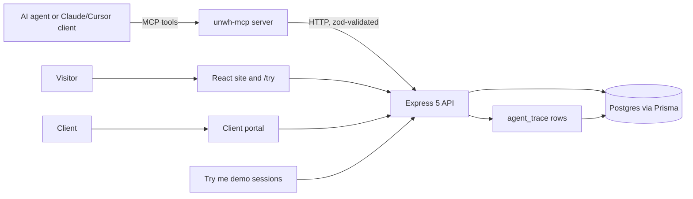

# Architecture

UnwhelmNet20 is one TypeScript codebase that serves the public site, a client portal, a REST API, and an MCP server that AI agents use to build proposals.

- **MCP server** (`unwh-mcp/`): about 80 tools that wrap the API. Agents never set hours or price; those stay with staff.
- **API** (`server/`): Express 5 with zod schemas and one response envelope (`ok, changed, entity, warnings, links, requestId`). Every route is declared in `server/apiSurface.ts`.
- **Data** (`prisma/`): Postgres. Rules, templates, section limits, and pricing models are rows, not hardcoded values.
- **Proposal completion tree**: each proposal copies template nodes and tracks each node as open, drafted, needs review, agreed, or locked, so progress reads as "9 of 12 parts settled."
- **Guidance playbook (Approach A)**: on each agent progress or chat turn, signals are computed, matching `guidance_rule` rows are ranked, a few client phrases are injected, and a `guidance_session_event` is stored. Details: [guidance-playbook-turns.md](guidance-playbook-turns.md).
- **Traces**: every agent call is logged to `agent_trace`, so a run can be replayed and audited.
- **Try me** (`/try`): a public, rate-limited sandbox that runs a real agent session against demo data; an hourly job purges old demo rows.
